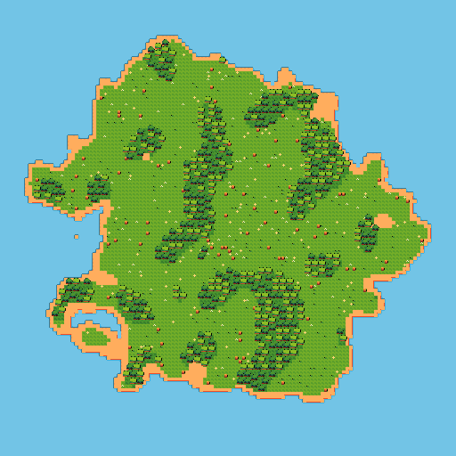

# Primal Isle — เกาะดึกดำบรรพ์ 🦖

เกมเอาชีวิตรอดออนไลน์มุมมองจากด้านบน คนยุคปัจจุบันหลุดมาติดเกาะยุคไดโนเสาร์
เก็บของ คราฟต์ สร้างฐาน ล่าและเทมไดโนเสาร์ เล่นกับเพื่อนผ่านเว็บได้ทุกแพลตฟอร์ม (มือถือ แท็บเล็ต คอม)

> ชื่อเกมเป็นชื่อชั่วคราว




## สถานะตอนนี้ (ขั้นที่ 1–2)

✅ สร้างเกาะสุ่มจาก seed · ✅ ส่งลิงก์/รหัสให้เพื่อนเข้าโลกเดียวกัน (สูงสุด 8 คน)
✅ เดินพร้อมกันแบบลื่น (prediction) · ✅ คีย์บอร์ด WASD และ joystick บนมือถือ · ✅ แจ้งเตือนเมื่อเน็ตหลุด
✅ ภาพ pixel art ของ Pixel-boy (CC0): ชายฝั่งโค้ง ต้นไม้ ดอกไม้ ตัวละครมีท่าเดิน 4 ทิศ

✅ ขั้นที่ 3: ตีต้นไม้/ทุบหิน/เก็บผลไม้/ถอนหญ้า (งอกใหม่ได้) · กระเป๋า · เลือด/ความอิ่ม/น้ำ · กินผลไม้ · ดื่มริมน้ำ · สลบแล้วฟื้น

✅ ขั้นที่ 4: คราฟต์ขวานหิน/ค้อนหิน (เก็บได้ 2 เท่า) และกองไฟ · วางกองไฟ · ย่างผลไม้ (อิ่มกว่า)

✅ ขั้นที่ 5: สร้างกำแพง/ประตู/ที่นอน (ฟื้นที่ที่นอน) · รื้อได้ของคืน · ตายแล้วทิ้งถุงของไว้ · **บันทึกโลกถาวร** — ปิดเซิร์ฟเวอร์แล้วกลับเข้ารหัสเดิมได้ ของในกระเป๋ายังอยู่

ขั้นต่อไป: ไดโนเสาร์ (ล่า/เทม) + ขึ้นเซิร์ฟเวอร์ออนไลน์ — ดูแผนทั้งหมดใน [เอกสารออกแบบ](docs/superpowers/specs/2026-11-21-primal-isle-design.md)

## รันบนเครื่อง

ต้องมี [Node.js](https://nodejs.org/) เวอร์ชัน 22 ขึ้นไป

```bash
npm install
npm test               # รันเทสต์ทั้งหมด
```

เปิด **2 หน้าต่าง terminal**:

```bash
npm run dev:server     # หน้าต่างที่ 1: เซิร์ฟเวอร์เกม (พอร์ต 2567)
npm run dev:client     # หน้าต่างที่ 2: หน้าเว็บเกม (พอร์ต 5173)
```

แล้วเปิด http://localhost:5173 ในเบราว์เซอร์ → ใส่ชื่อ → **สร้างโลกใหม่**

**ปิดเซิร์ฟเวอร์:** กด `Ctrl+C` ในหน้าต่างเซิร์ฟเวอร์ — เกมจะบันทึกทุกโลกที่เปิดอยู่ก่อนปิด
(โลกยังบันทึกเองทุก 30 วินาที และตอนทุกคนออก) ไฟล์อยู่ที่ `server/data/worlds/<รหัสโลก>.json`
ครั้งหน้าเปิดเซิร์ฟเวอร์ใหม่ แล้วใส่ **รหัสโลก** เดิมในเมนู ก็กลับเข้าโลกเดิมได้

> คนเขียนโค้ด: `npm run watch -w server` = เซิร์ฟเวอร์ที่รีสตาร์ทเองเมื่อแก้โค้ด (แต่ Ctrl+C แบบนี้อาจไม่ทันบันทึก)

## เล่นกับเพื่อน (Wi-Fi วงเดียวกัน)

1. รันทั้ง 2 คำสั่งข้างบนบนคอมของคุณ
2. หา IP ของคอม: Windows พิมพ์ `ipconfig` ใน terminal ดูบรรทัด **IPv4 Address** (เช่น `192.168.1.23`)
3. ครั้งแรกที่รัน Windows อาจถามเรื่อง Firewall ให้กด **Allow** สำหรับ Node.js (ถ้าพลาดไป: ตั้งค่า Windows Defender Firewall → อนุญาตแอป → ติ๊ก Node.js ทั้ง Private)
4. บนคอม ให้เปิดเกมผ่าน `http://<IP ของคอม>:5173` (ไม่ใช่ localhost) แล้วสร้างโลก
5. กด **📋 คัดลอกลิงก์เชิญ** ที่มุมขวาบน แล้วส่งให้เพื่อน (LINE ฯลฯ) — เพื่อนที่ต่อ Wi-Fi เดียวกันกดลิงก์ก็เข้าโลกได้เลย
   ถ้าคัดลอกไม่ได้ ให้บอกเพื่อนเปิด `http://<IP ของคอม>:5173` แล้วใส่ **รหัสโลก**

> เล่นข้ามเน็ต (คนละบ้าน) จะทำในขั้นที่ 6 ตอนย้ายเซิร์ฟเวอร์ขึ้นออนไลน์

## การควบคุม

| | คอม | มือถือ (แนวนอน) |
|---|---|---|
| เดิน | WASD หรือ ลูกศร | แตะครึ่งจอซ้ายแล้วลาก (joystick) |
| เก็บของ / ดื่มน้ำ (สิ่งที่ใกล้ที่สุด) | Space หรือ E (กดค้างได้) | ปุ่ม ✋ มุมขวาล่าง |
| กินผลไม้ / ผลไม้ย่าง | คลิกในกระเป๋า | แตะในกระเป๋า |
| คราฟต์ | ปุ่ม 🔨 ข้างกระเป๋า | ปุ่ม 🔨 ข้างกระเป๋า |
| วางกองไฟ/กำแพง/ประตู/ที่นอน | หันไปทางที่จะวาง แล้วคลิกของในกระเป๋า (วางช่องหน้าตัว) | หันแล้วแตะของในกระเป๋า |
| รื้อสิ่งก่อสร้าง (ได้ของคืน) | ปุ่ม 🪓 ในแถวกระเป๋า (รื้อชิ้นที่ใกล้สุด) | ปุ่ม 🪓 |
| เก็บถุงของคนที่ตาย | ยืนข้างถุงแล้วกด Space/E | ยืนข้างถุงแล้วกด ✋ |
| ย่างผลไม้ | ยืนข้างกองไฟแล้วกด Space/E | ยืนข้างกองไฟแล้วกด ✋ |

## โครงสร้าง

| โฟลเดอร์ | หน้าที่ |
|---|---|
| `shared/` | กติกาเกมล้วนๆ (pure function) ใช้ร่วมกันทั้งสองฝั่ง |
| `server/` | เซิร์ฟเวอร์ Colyseus — ตัดสินผลทุกอย่างในโลก |
| `client/` | หน้าจอเกม Phaser — วาดภาพ รับ input แสดง UI |
| `docs/` | เอกสารออกแบบ แผนงาน และสรุปสถานะโปรเจกต์ |

## License

โค้ด: MIT · ที่มาของภาพ/เสียงดูที่ [CREDITS.md](CREDITS.md)
